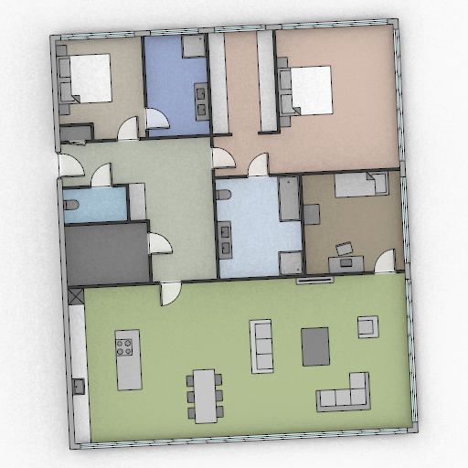
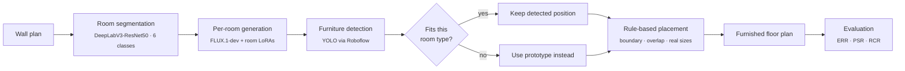
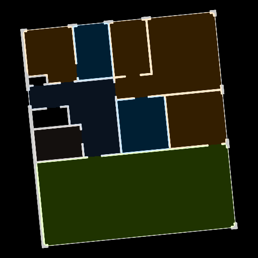
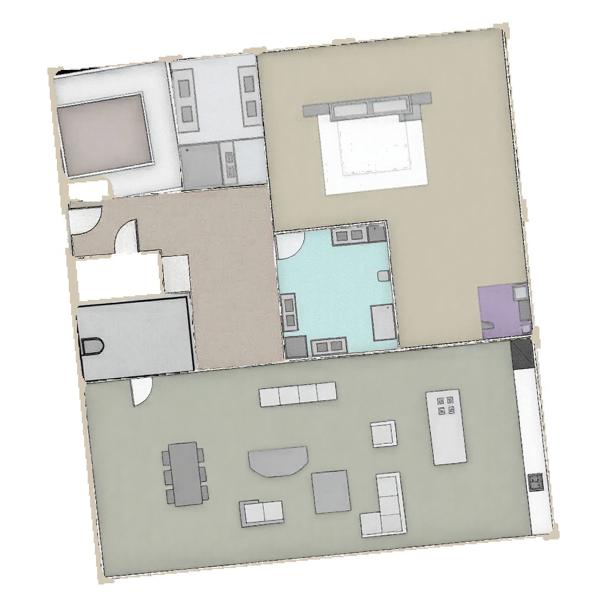
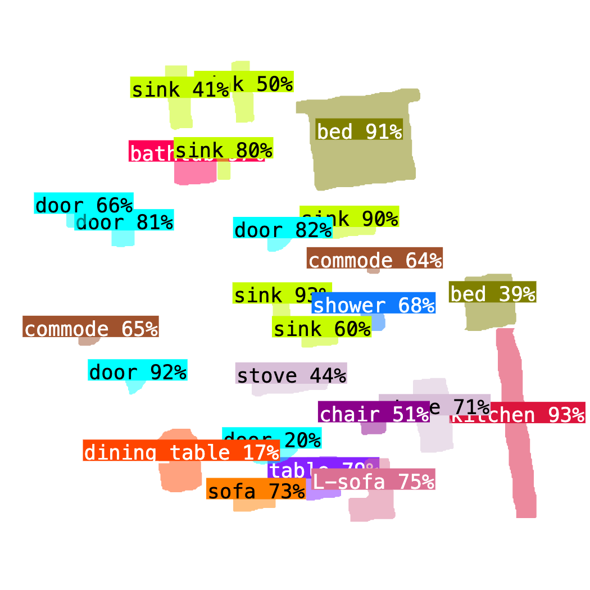
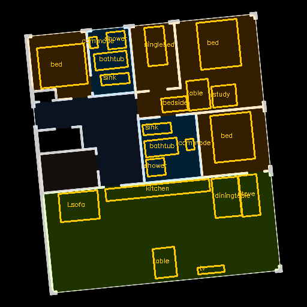

<div align="center">

# Hybrid Floor Plan Generation

**From a bare wall plan to a fully furnished floor plan, using deep learning, diffusion and geometric rules together.**




</div>

---

## The idea

Generative models can draw beautiful rooms, but they **hallucinate**: a bathtub in the living
room, a bed spilling through a wall, furniture stacked on top of itself. Rule-based systems
are reliable but look rigid and repetitive.

This capstone project combines the two. Each stage handles the part it's good at:

| Stage | What it contributes |
|---|---|
| **CNN segmentation** | Understands the plan: which region is a bedroom, bathroom, hallway… |
| **LoRA diffusion** | Imagines a realistic, styled furniture layout for each room |
| **YOLO detection** | Turns the generated pixels back into structured furniture objects |
| **Rule-based placement** | Filters hallucinations and enforces walls, overlap and real-world sizes |

The result is a furnished plan that is **visually rich and geometrically valid**.

---

## How it works



<table>
  <tr>
    <td align="center"><br><b>1 · Segment</b></td>
    <td align="center"><br><b>2 · Generate</b></td>
    <td align="center"><br><b>3 · Detect</b></td>
    <td align="center"><br><b>4 · Place</b></td>
  </tr>
</table>

### 1 · Room segmentation
A `deeplabv3_resnet50` model labels every pixel of a 512×512 wall plan as one of six
classes. Each class has a fixed color that every later stage depends on:

| Class | RGB | Class | RGB |
|---|---|---|---|
| Bedroom | `[255,154,0]` | Living room | `[155,255,0]` |
| Hallway | `[50,99,155]` | Empty room | `[100,80,71]` |
| Bathroom | `[0,155,255]` | Background | `[0,0,0]` |

### 2 · Per-room LoRA generation
Each room is cut out of the plan and passed to **FLUX.1-dev** with a LoRA adapter trained
for that room type (bedroom, living room, bathroom, toilet, hallway). The room's mask
conditions the generation, so the furniture follows the room's real shape.

### 3 · Furniture detection
A YOLO model (Roboflow `furniture-ya4pe/1`) finds beds, sofas, sinks, tables, doors and
more in the generated images. Real-world dimensions come from
[`furniture_measurements.json`](data/furniture_crops/furniture_measurements.json).

### 4 · Rule-based integration
The `FurnitureMapper` drops furniture that doesn't belong (no stove in the bedroom), and the
`EnhancedFurniturePlacer` puts everything at real scale:

- the **whole furniture polygon** must sit inside the room, not just its center
- no overlapping pieces
- per-room limits (one bed, up to two bedside tables, …)
- detected items are drawn in **green**, rule-based fallbacks in **yellow**

### 5 · Evaluation
Every output is scored on boundary violations, overlap, **ERR** (empty-room rate),
**PSR** (placement success rate) and **RCR** (rule-compliance rate).

---

## Highlights

<div align="center">

| Segmentation accuracy | Generation success | Placement success | Integration time |
|:---:|:---:|:---:|:---:|
| **~93%** | **90%+** | **~90%** | **~12–18 s** |
| 6-class validation | across 5 room types | detected + rule-based | per plan, T4 GPU |

</div>

Full experiments and discussion: [`docs/notes/CHAPTER_10_RESULTS.md`](docs/notes/CHAPTER_10_RESULTS.md).

---

## Interactive furniture app

A **Streamlit** app lets you rearrange furniture on a segmented plan yourself. It checks
room boundaries as you go, shows sizes in meters and exports the layout as JSON or PNG.

```bash
cd apps/furniture_customization
pip install -r requirements.txt
streamlit run interactive_furniture_app.py
```

---

## Getting started

The pipeline runs on **Google Colab with a GPU**.

1. **Open a notebook in Colab.** Use [`notebooks/pipelines/full_pipeline.ipynb`](notebooks/pipelines/full_pipeline.ipynb)
   for end to end, or a stage notebook to run one step.
2. **Mount Google Drive.** Notebooks read data, model weights and the `floor_planrules`
   modules from `/content/drive/MyDrive/...`. Edit the config cell at the top to match your
   Drive layout. Model weights (`*.pth`, `*.safetensors`) are not stored in this repo.
3. **Add your secrets.** In Colab's **Secrets** panel, add `HF_TOKEN` (for FLUX.1-dev)
   and `ROBOFLOW_API_KEY`, and turn on notebook access. For local runs, copy
   `.env.example` to `.env`. Never commit real keys.
4. **Run all cells.**

---

## Repository layout

```
notebooks/
   ├── 01_segmentation/         roomClassifyCNN (training), room_inference
   ├── 02_lora_generation/      bedroom, living room, bathroom, toilet, hallway, master
   ├── 03_furniture_detection/  furniture_detection
   ├── 04_integration/          FurnitureDetector, FurnitureMapper, EnhancedFurniturePlacer
   ├── 05_evaluation/           furniture_polygon_eval
   ├── pipelines/               full_pipeline (end to end), lora_inference_pipeline (stages 1–2)
   └── archive/                 older or alternate notebook versions
src/floor_planrules/            rule-based placement modules
apps/furniture_customization/   Streamlit app
data/furniture_crops/           furniture crops + real-world measurements
docs/
   ├── reports/                 phase 2 & 3 reports, research_paper.tex
   ├── notes/                   phase 3 review, chapter 10 results
   ├── scripts/                 python-docx report generators
   └── figures/                 figures for the paper and reports
papers/                         reference papers
```

---

## Reports & paper

```bash
pip install python-docx
python docs/scripts/create_phase3_doc.py      # → docs/reports/
```

Build `docs/reports/research_paper.tex` from inside `docs/reports/`. Figures resolve through
`\graphicspath{{../figures/}}`.

---

<div align="center">

**Built as a capstone research project** · CNN × Diffusion × YOLO × Rules

</div>
